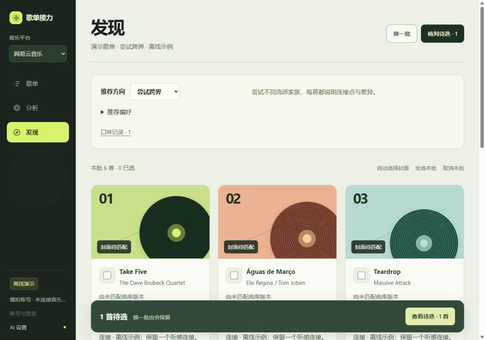
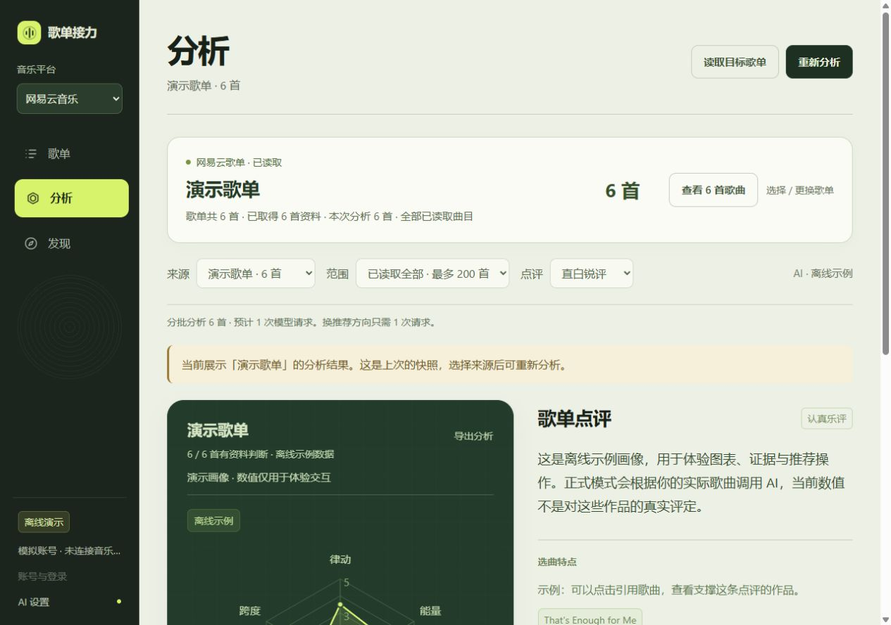
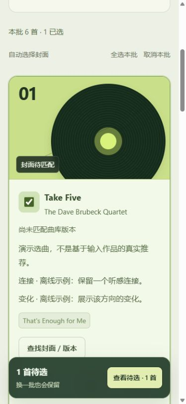

# 歌单接力 · Playlist Relay

**v0.7.0-beta.1 测试版** · 本地运行 · 网易云音乐 / QQ 音乐 · Spotify / Apple Music（测试接入）

[](https://github.com/Delonixx/playlist-relay/actions/workflows/test.yml)
[](LICENSE)

把一系列歌曲带进自己的歌单，再用歌单画像与主动反馈发现新歌。

歌曲列表 → 搜索与版本核对 → 歌单分析 → 推荐与口味反馈 → 待选核对 → 确认追加

2026-10-11，用户已确认网易云、QQ 音乐实测可用。新增 Spotify 与 Apple Music **测试版接入**，授权、搜索和追加代码已实现，但尚未完成真实账号验收。国内平台使用非官方接口，兼容情况可能变化；用户实测反馈不等于所有账号或权限组合均已验证。

| 音乐平台 | 当前状态 | 登录与主要能力 |
|---|---|---|
| 网易云音乐 | 用户已实测可用 | App 扫码 / 已有 Cookie、搜索核对、歌单追加 |
| QQ 音乐 | 用户已实测可用 | 手机 QQ / 微信扫码、备用 Cookie、搜索核对、歌单追加 |
| Spotify | **测试版 Beta，真实账号尚未验收** | 官方 PKCE 授权、搜索、私密歌单创建、已有歌单追加；需自己的 Client ID |
| Apple Music | **测试版 Beta，真实账号尚未验收** | 官方 MusicKit 授权、本地签名、可编辑资料库歌单追加；需开发者配置 |

新平台配置见 [全球平台接入](全球平台接入.md)。Spotify 平台内容不用于 AI 点评或画像。Apple 首版仅追加已有可编辑歌单。离线演示使用示例数据，不启用两个新平台或接收凭证。

## 看看界面

以下截图均来自明确标注的离线演示，图表数值与选曲用于演示交互。



<details>
<summary>查看分析页与手机界面</summary>





</details>

## 能做什么

- **文字列表导入**：支持歌名与歌手、Markdown 编号、去重；搜索后逐首核对专辑和现场 / 混音等录音版本。
- **国内双平台连接**：网易云 App 扫码；QQ 默认手机 QQ / 微信扫码，Cookie 仅作备用。
- **全球平台测试接入**：Spotify 官方 PKCE、Apple Music 官方 MusicKit；支持搜索、发行版本核对和既有歌单追加，需各自开发配置。音乐令牌只在本地会话保存。
- **有依据的歌单画像**：分批分析最多 200 首，六维图、点评与参考歌曲；点击维度查看分数定义和单曲理由。
- **独立音乐发现**：贴近口味、向外延伸、尝试跨界；重新推荐复用画像，不必重新读取或打分。
- **主动口味反馈**：喜欢、少推荐、听过可以查看和撤销；在下次主动生成时提供给 AI。
- **选择不会随换批丢失**：跨批次待选保留录音版本，再进入现有匹配与确认流程。待选仅保留在当前页面，刷新会清空。
- **核对后追加**：网易云 / QQ / Spotify 只处理本人创建的歌单，Apple 只处理明确可编辑的资料库歌单；跳过已有歌曲，每批最多 10 首，追加后读回核验；拒绝或超时不自动重试写入。Apple 更新延迟时仅做有限的只读核验。

## 快速开始

需要 Node.js 22 或更新版本，推荐 Node.js 24。Windows 可使用项目内的 `.cmd`，其他系统使用终端命令。

### 先体验离线演示

```sh
git clone https://github.com/Delonixx/playlist-relay.git
cd playlist-relay
node server.mjs --demo
```

不需要安装音乐 API 依赖。也可在 Windows 双击 `预览新版.cmd`，使用端口 8772。

从终端打开“请打开”后的**完整本地地址**，包括 `#` 后的访问令牌。默认命令端口为 8765；只有本机可以连接。

### 正式连接音乐平台

在项目目录运行：

```sh
npm install --global pnpm@11.25.0
pnpm install --frozen-lockfile --ignore-scripts --registry=https://registry.npmjs.org
pnpm start
```

已有 pnpm 11.25.0 可跳过第一行。Windows 安装依赖后也可双击 `start.cmd`。默认端口 8765；停止服务按 Ctrl+C，音乐登录与 AI Key 随进程退出清除。

1. 选择平台。网易云 / QQ 扫码并在手机确认；Spotify / Apple Music 测试版先按 [接入说明](全球平台接入.md) 配置，再通过官方网页授权。
2. 粘贴每行一首的 `歌名 — 歌手`，点搜索并匹配。
3. 核对曲库候选、专辑和录音版本，跳过不确定的歌曲。
4. 选择自己创建的目标歌单，确认后追加，查看读回核验结果。

```text
That's Enough for Me — Patti Austin
If I Ain't Got You — Alicia Keys
So Sick — Ne-Yo
```

### 使用 AI 分析与推荐

在“AI 设置”中选择智谱、硅基流动、通义百炼或 DeepSeek，填写该服务的 API Key。免费额度、模型可用性与价格以服务商控制台为准；本项目不提供共享 Key，也不保证永久免费。

读取已有歌单或添加歌曲后开始分析，再到“发现”修改方向、偏好、换一批或记录口味。不会自动重试模型请求。

**六维分数来自歌曲资料与模型知识估计，未分析音频；低分表示特征较少，不表示作品或个人品味差。**

详细安装、使用和故障说明见 [使用说明](docs/使用说明.md)与 [QQ 接入说明](QQ接入.md)。

## 数据放在哪里

| 数据 | 保存与传递 |
|---|---|
| 音乐 Cookie、扫码授权资料、OAuth 用户令牌、AI Key | 本机进程内存；不写文件或浏览器存储，停止服务清除 |
| Apple MusicKit .p8 私钥 | 可选由服务读取用户明确指定的本机文件进行签名；不上传私钥。官方 SDK 可能保留自己的浏览器登录状态 |
| 主动口味记录 | 当前浏览器保存歌曲名、歌手和标记，最多 200 条；下次主动生成时发给所选 AI，可撤销 / 清除 |
| 待选歌曲与版本 | 当前页面内存；换批保留，刷新 / 关闭页面清空 |
| AI 分析内容 | 向所选服务发送歌曲资料与偏好；不发送音乐 Cookie、账号身份或歌单链接 |

应用绑定 `127.0.0.1`，使用每次启动生成的访问令牌。不要把完整本地地址、Cookie、Key 或扫码授权地址发到 Issue。

## 验证与已知限制

| 项目 | 当前证据 |
|---|---|
| 匹配、版本延续、分析与推荐状态、反馈、导入保护、新平台授权与追加协议 | 111 项本机模拟测试通过；本次 GitHub Actions 运行结果见上方 Tests |
| 既有桌面 / 手机排版 | v0.6.3 曾完成 1280×900、390×844、320×740 浏览器检查；新增授权页尚未完成视觉验收 |
| 网易云 / QQ 使用 | 2026-10-11 用户确认两平台可用；不是所有账号 / 扫码方式 / 权限组合的全面验收 |
| Spotify / Apple Music 授权与写入 | 测试版；代码与模拟流程通过，尚无真实账号授权及写入证据 |
| AI 推荐质量、不同方向的真实听感差异 | 尚未完成真实听感评估 |

不下载音频、不提供账号密码登录、不保证接口长期有效。封面跟随实际曲库候选，未取得时使用原创几何占位。网易云缺少歌曲收藏人数数据；QQ 收藏显示是平台量级，不是全曲库精确排名。

报告问题时给出版本、平台、操作步骤和不含凭据的短错误提示。贡献说明见 [CONTRIBUTING](CONTRIBUTING.md)，隐私与安全边界见 [SECURITY](SECURITY.md)。

## 开发与许可

```sh
pnpm test
```

Node.js + 原生 HTML / CSS / JavaScript，无前端构建步骤。测试使用本地模拟适配器，不需要音乐账号或付费模型。CI 覆盖 Windows / Ubuntu 与 Node.js 22 / 24。

本项目代码采用 [MIT](LICENSE)。固定网易云依赖及素材来源见 [第三方说明](THIRD_PARTY_NOTICES.md)和 [素材来源](素材来源.md)；依赖自身许可证与实际封面权利保持独立。
